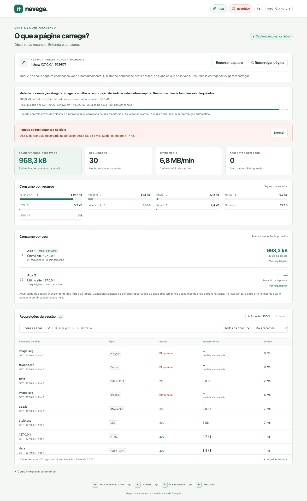

# Navega • Monitor de recursos

Primeira implementação da **Extensão Autoadaptativa para Gestão de Orçamento de Dados na Navegação Web com MAPE-K**, da disciplina de Sistemas Adaptativos. A versão 0.5.0 implementa a primeira etapa de adaptação: modos Normal, Econômico e Restritivo por metas internas do sistema sobre o consumo observado na captura atual. Período da franquia, alertas e histórico de sessões anteriores ficam para as próximas entregas, uma de cada vez.

Abra uma página, inicie a captura uma vez e alterne entre as abas: o monitoramento acompanha automaticamente a aba ativa. Veja as requisições HTTP(S), seus tipos, status, duração e bytes recebidos informados pelo Chrome. O painel mostra totais, distribuição por recurso, ritmo médio e falhas. É possível buscar, filtrar por tipo e aba de origem, ordenar e exportar a sessão em JSON. Os totais abrangem todas as abas visitadas durante a sessão.

O botão de engrenagem permite configurar plano, franquia em MB/GB, ativar/desativar a economia automática. As metas de 70% e 90% pertencem à política do sistema, sem campos para o usuário estimar os limites. O modo muda automaticamente durante a captura. **O consumo desta etapa é somente o da captura atual, não o da franquia mensal real.** A configuração persiste; os contadores ainda não são um histórico permanente.



## Apresentar em cinco minutos

**Requisitos:** Google Chrome 125 ou superior. Node.js 22 ou superior somente para a página local de demonstração. A extensão funciona sem instalação de pacotes e sem build.

1. No Chrome, acesse `chrome://extensions`.
2. Ative **Modo do desenvolvedor**, clique em **Carregar sem compactação** e selecione a pasta [`extension/`](extension).
3. Fixe a extensão **Navega • Monitor de recursos** na barra do navegador.
4. No terminal do VS Code, na raiz deste repositório, execute:

   ```sh
   npm run demo
   ```

5. Abra **http://127.0.0.1:4173** no Chrome.
6. Clique no ícone da extensão, depois em **Iniciar captura** e **Recarregar página**.
7. Experimente os botões da página e observe o painel. Troque de aba para testar a captura automática, sem encerrar nem iniciar outra sessão. Use **Abrir painel amplo** para projetar a tabela em uma aba maior.
8. Use **Encerrar captura** e **Exportar JSON** para guardar a evidência. Encerrar interrompe o sensor e preserva os registros. **Iniciar nova sessão** substitui a anterior.

O aviso de depuração do Chrome é esperado: o sensor usa `chrome.debugger` para acessar o domínio Network do Chrome DevTools Protocol. Não abra o DevTools da **aba monitorada** durante a demonstração: ele pode desconectar a captura. Se isso acontecer, os registros são preservados e o painel informa a desconexão.

Veja o [roteiro de apresentação](docs/DEMONSTRACAO.md), o [mapeamento da arquitetura](docs/ARQUITETURA.md) e as [próximas etapas](docs/PROXIMAS-ETAPAS.md).

## Escopo desta entrega

| Parte da arquitetura                     | Implementação                                                                                   |
| ---------------------------------------- | ----------------------------------------------------------------------------------------------- |
| Sensor                                   | Adaptador CDP que acompanha automaticamente a aba ativa e instrumenta iframes/workers dedicados |
| Coletor de requisições                   | Registra o ciclo de vida, erros, redirecionamentos e contextos                                  |
| Classificador de recursos                | HTML, CSS, JavaScript, imagem, áudio, vídeo, mídia, fonte, Fetch/XHR e outros                   |
| Estimador de consumo                     | Usa bytes recebidos informados pelo Chrome; mantém valores parciais ou desconhecidos explícitos |
| Agregador de métricas                    | Totais, tipos, domínios, ritmo médio, cache, pendências e falhas                                |
| Conhecimento                             | Sessão temporária e configuração persistente do orçamento e do plano                            |
| Análise, Planejamento, Execução e Efetor | Comparam consumo com X/Y, selecionam o modo e aplicam regras declarativas por aba               |

O sistema gerenciado continua sendo **o carregamento de recursos no Chrome**. Os sensores são implementados na extensão e interagem com as APIs do navegador. As regras de rede são o ponto principal de economia. Um controle complementar de reprodução, em mundo isolado via CDP, pausa mídia já carregada e oculta elementos de imagem no modo Restritivo; isso altera temporariamente a apresentação do DOM, sem modificar os arquivos do servidor.

## Interpretar os tamanhos

- **Transferência observada:** `Network.loadingFinished.encodedDataLength`, total recebido informado pelo Chrome. Enquanto a requisição está em andamento, usamos os dados parciais disponíveis; o total final os substitui.
- **Tamanho descomprimido:** soma de `Network.dataReceived.dataLength`, disponível no JSON como `decodedBytes`. É diferente dos bytes transferidos e pode estar indisponível.
- **Cache:** recursos servidos de memória/disco podem ter transferência de **0 B**, embora tenham conteúdo. Respostas de service worker são identificadas; seu eventual tráfego de origem não é contabilizado como uma medição independente.
- **“—”:** valor desconhecido, não zero. Falhas e capturas interrompidas podem ter somente bytes parciais.
- **Ritmo médio:** bytes observados divididos pelo tempo da sessão, em bytes/minuto. Não mede a velocidade da conexão e congela ao encerrar.

São unidades decimais: **1 kB = 1.000 B; 1 MB = 1.000.000 B**. O total não equivale ao consumo cobrado pela operadora: não inclui uploads, overhead completo de rede, abas inativas/outros aplicativos ou frames de WebSocket. Streaming contínuo pode continuar parcial. A captura começa quando o usuário a inicia; recursos anteriores exigem recarregar a página.

## Dados e limites

- Uma sessão por vez, acompanhando automaticamente a aba ativa. Ao trocar de aba ou janela, o sensor muda de alvo e preserva os registros anteriores. As abas inativas deixam de ser observadas. Requisições ainda pendentes na troca são marcadas como interrompidas, preservando os bytes parciais; retornar à aba não recupera eventos perdidos enquanto ela estava inativa.
- Abas vazias e páginas internas entram em espera sem encerrar a sessão. Ao visitar uma página HTTP(S), a captura retoma automaticamente. O próprio painel amplo é uma exceção: abri-lo mantém o último alvo. Fechar a aba monitorada mantém a sessão ativa para acompanhar a próxima página. **Encerrar captura** desliga a automação.
- Ao ativar uma aba que já terminou de carregar, somente as próximas requisições serão observadas. Recarregue manualmente se quiser registrar o carregamento inicial completo; a extensão não recarrega páginas por conta própria.
- Até **3.000 requisições por sessão**. Ao atingir o limite, o painel informa que novos registros foram ignorados; os totais cobrem apenas os registros retidos. Exporte e inicie outra sessão.
- Registros de captura ficam na memória da sessão do navegador: reabrir o painel preserva os dados, reiniciar o navegador os remove. A configuração de orçamento usa `chrome.storage.local` e permanece disponível após reiniciar o navegador.
- Sem coleta de corpos das respostas, cookies ou cabeçalhos de autenticação. URLs são armazenadas sem query string, fragmento ou credenciais. Caminhos ainda podem conter informações pessoais; revise o JSON antes de compartilhar.
- Sem servidor de telemetria. O servidor da demo atende apenas no loopback `127.0.0.1`.
- Páginas internas e protegidas do Chrome não podem ser monitoradas. Iframes e workers instrumentados são observados, mas há limites de cobertura em transições de contexto, service workers e conexões de longa duração.
- Permissões: `debugger` observa a rede da aba selecionada; `tabs` identifica o alvo e detecta mudanças de aba; `sidePanel` apresenta o painel; `storage` mantém a sessão e a configuração; `declarativeNetRequest` bloqueia novos recursos conforme o modo. A permissão de depuração é ampla, mas o código só habilita observação de rede e instrumentação de contextos.

## Desenvolvimento e verificação

```sh
npm ci
npx playwright install chromium
npm run check
npm test
npm run test:e2e
```

O teste de navegador carrega a extensão real em um perfil temporário do Chrome for Testing. Verifica captura, tamanhos, cache, erro HTTP, redirecionamentos, mídia, contexto de iframe/worker, filtros, exportação, reabertura do painel e encerramento, além de troca automática de abas, trocas rápidas, retomada após uma aba vazia e fechamento do alvo. As evidências ficam em `artifacts/` e não entram no Git. O perfil temporário é removido após o teste; o Chrome pessoal não é alterado.

Para empacotar somente a extensão: `npm run package`. O ZIP fica em `dist/navega-extension.zip`; extraia antes de usar **Carregar sem compactação**. A página demo não faz parte do pacote da extensão.

O áudio, as imagens e o vídeo da demo são gerados para o projeto. O vídeo já está versionado; regeneração opcional: `node scripts/generate-demo-video.js` (requer Playwright e Chromium). Os preenchimentos dos SVGs criam tamanhos controlados para demonstração, não uma representação de imagens comprimidas reais.

## Referências

O escopo e a separação entre sistema gerenciador/gerenciado seguem a [conversa de referência fornecida pela equipe](https://chatgpt.com/share/6af33288-dfb4-83e9-b084-05b64c38edd6) e a [figura da arquitetura](docs/arquitetura-referencia.png). O histórico orienta a arquitetura; exemplos de políticas discutidos ali não foram tratados como funcionalidades obrigatórias desta primeira entrega.

Implementação baseada na documentação oficial de [chrome.debugger](https://developer.chrome.com/docs/extensions/reference/api/debugger), [Side Panel](https://developer.chrome.com/docs/extensions/reference/api/sidePanel), [storage.session](https://developer.chrome.com/docs/extensions/reference/api/storage) e [Network do CDP](https://chromedevtools.github.io/devtools-protocol/tot/Network/). O uso de CDP é uma escolha do sensor deste protótipo; a arquitetura permite substituí-lo futuramente por uma estratégia menos intrusiva.

## Atualizar uma instalação existente

Em `chrome://extensions`, clique em **Recarregar** no cartão do Navega e reabra o painel. A versão **0.5.0** mantém o monitoramento e o ranking, e acrescenta os modos automáticos de economia. O Chrome pode solicitar a nova permissão para bloquear conteúdo. Confira as instruções de teste da etapa 1 abaixo.

## Comparar o consumo das abas

A seção **Consumo por aba** ordena as abas pelo total de bytes observados e destaca a maior transferência positiva. Empates no maior valor são sinalizados; sem bytes conhecidos, nenhuma aba é declarada vencedora. Cada linha mostra quantidade de requisições, pendências, tamanhos desconhecidos e participação no total observado. O botão **Ver requisições** seleciona a aba e limpa os filtros de busca/tipo para mostrar seus recursos. Os subtotais também entram no JSON em `metrics.byTab`.

O ranking, os cartões e o gráfico por recurso mostram o acumulado da sessão inteira, independente dos filtros da tabela. O subtotal de uma aba inclui todas as navegações observadas nela; o endereço exibido identifica o último site visitado, não uma soma exclusiva daquele site. Somente os períodos monitorados são comparados, sem normalização por tempo. Recursos com tamanho desconhecido ficam fora da soma; uma aba com todas as requisições sem tamanho exibe **—**, e uma aba sem requisições ou apenas com transferência conhecida de zero exibe **0 B**.

## Etapa 1: testar os três modos

1. Recarregue o Navega em `chrome://extensions` e reabra o painel.
2. Na engrenagem, informe um plano com **1 MB** e mantenha a economia automática ativa. Salve. Você não escolhe os limites; a política do sistema decide pelos níveis internos de 70% e 90%.
3. Execute `npm run demo`, abra `http://127.0.0.1:4173`, inicie a captura e recarregue a página.
4. Em **Normal**, carregue imagens e mídia e comece a reproduzir o áudio. Tudo deve funcionar normalmente.
5. Use **Consumir 100 kB de teste** até o modo confirmado ser **Econômico**. O áudio que já estava tocando deve parar; tentar tocar o conteúdo do buffer não deve produzir som. Novos áudios e vídeos também serão bloqueados, enquanto imagens e texto continuam permitidos.
6. Continue até **Restritivo**. Imagens já exibidas também serão ocultadas, e novos downloads serão bloqueados. Não é preciso recarregar para interromper a reprodução já carregada.
7. Para testar a reversão sem perder os registros, aumente a franquia para **10 MB** ou desative a economia automática e salve. A indicação volta a **Normal** e as próximas requisições voltam a carregar. Encerrar a captura também remove as regras.

Os limites são calculados sobre a transferência acumulada de todas as abas observadas nesta captura. Os bloqueios se aplicam somente à aba monitorada; ao mudar de aba, são removidos da anterior e aplicados à nova. HTML, CSS, JavaScript e fontes são preservados. Áudio e vídeo HTML já carregados são pausados e sua retomada é impedida enquanto o modo estiver ativo. Imagens em elementos HTML/SVG são ocultadas no Restritivo e restauradas ao voltar ao Normal. Isso não desfaz os bytes já transferidos; a extensão não recarrega páginas automaticamente.

A implementação usa tipos `media`/`image` e, para Fetch/XHR, extensões de arquivos comuns no caminho da URL. Não bloqueia APIs de texto/JSON genericamente. O controle DOM também atua sobre mídia já carregada, inclusive no buffer, e a aba é silenciada como proteção adicional para Web Audio/players fora dos elementos comuns. Players não padronizados podem continuar processando silenciosamente; isso não equivale a cancelar todos os downloads de todo site.

O painel anuncia o modo depois de aplicar as regras e o controle de conteúdo; falhas são sinalizadas. Essa confirmação da API é diferente de comprovar o bloqueio de todo conteúdo de um site; os testes da demo verificam ambos os pontos. Atualizações são agrupadas (250 ms), portanto requisições já iniciadas antes da aplicação do novo modo podem terminar normalmente.

**Ainda pendentes, para teste incremental:** item 2: datas/ciclo e reinicialização da franquia; item 3: alertas e contador persistente de uso; item 4: consulta de sessões anteriores. Iniciar outra captura ou reiniciar o navegador ainda zera a base de consumo usada por esses limites.

`npm run test:e2e` executa o monitoramento e depois os testes reais dos três modos, com verificação de que recursos bloqueados não chegaram ao servidor, preservação de texto/CSS/JS, escopo por aba e restauração do modo Normal. Evidências em `artifacts/modo-economico.png`, `artifacts/modo-restritivo.png` e `artifacts/adaptation-verification.json`.

### Metas automáticas e mídia do buffer (0.5.0)

A meta é preservar a franquia. A política centralizada em `extension/knowledge/adaptation-policy.js` define os níveis experimentais de 70% e 90%. A Análise usa esses níveis mesmo se uma configuração antiga ainda contiver X/Y; os campos antigos são removidos ao migrar a configuração. Não há seleção manual do modo nem edição dos percentuais na tela.

Ao entrar em Econômico/Restritivo, a extensão pausa e silencia elementos HTML de áudio/vídeo, impede novas tentativas de reprodução e silencia a aba como proteção adicional. O controle cobre elementos dinâmicos, shadow roots abertos e iframes instrumentados. No Restritivo, também oculta elementos de imagem já exibidos; backgrounds CSS e players gráficos especiais podem exigir tratamento adicional.

Ao voltar a Normal, desativar, encerrar ou trocar de aba, os estilos e o silenciamento da extensão são restaurados. Uma aba que o usuário já havia silenciado continua assim. A reprodução não é retomada automaticamente: é necessário clicar em play. O controle da página expira se perder o contato com a extensão, evitando alterações permanentes após desconexão/recarregamento.

O teste real reproduz um áudio antes de atingir a meta, confirma a pausa, tenta reproduzir novamente pelo buffer, testa áudio embutido em iframe de outra origem e verifica a liberação no Normal. Isso complementa a verificação de bloqueio de novas requisições no servidor.
