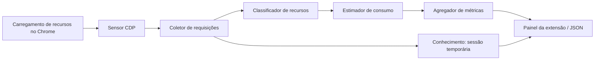
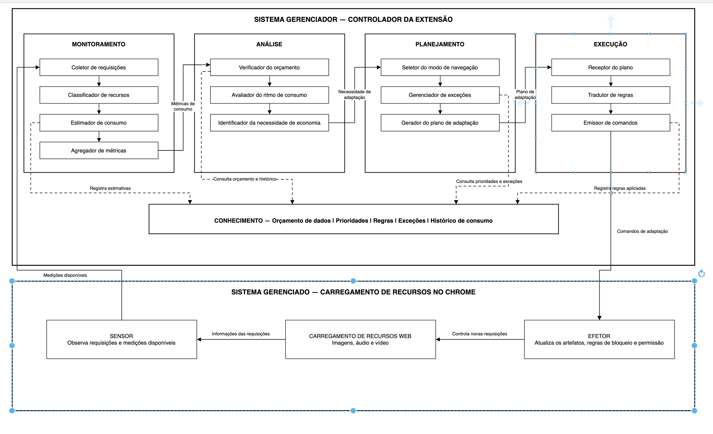

# Da arquitetura à primeira implementação

O projeto completo busca gerenciar um orçamento de dados com o ciclo MAPE-K. A entrega inicial implementa **M** e a parte de **K** necessária para guardar uma sessão observada. Não existe ciclo autoadaptativo completo ainda.

## Fluxo implementado

Não há seta de atuação sobre o Chrome nesta versão. A instrumentação do sensor permite observar a rede; nenhum plano de adaptação ou regra de filtragem é emitido.

| Componente da figura    | Arquivo                                         | Responsabilidade atual                                                          |
| ----------------------- | ----------------------------------------------- | ------------------------------------------------------------------------------- |
| Sensor                  | `extension/sensors/chrome-network-sensor.js`    | Início explícito da sessão; acompanha a aba ativa e seus contextos filhos       |
| Coletor                 | `extension/monitoring/request-collector.js`     | Normaliza eventos, separa requisições por contexto e preserva redirecionamentos |
| Classificador           | `extension/monitoring/resource-classifier.js`   | Usa tipo do Chrome e MIME; diferencia áudio/vídeo quando possível               |
| Estimador               | `extension/monitoring/consumption-estimator.js` | Interpreta tamanho conhecido, parcial, cache e indisponibilidade                |
| Agregador               | `extension/monitoring/metrics-aggregator.js`    | Consolida bytes e contadores por recurso/domínio e média por minuto             |
| Conhecimento            | `extension/knowledge/session-store.js`          | Guarda uma sessão em `chrome.storage.session`                                   |
| Controlador da extensão | `extension/background.js`                       | Coordena sensor, sessão e mensagens; não decide políticas de economia           |
| Interface               | `extension/ui/`                                 | Apresenta dados, controla captura e exporta evidências                          |

O controlador faz a ligação entre componentes. O coletor chama o classificador ao receber metadados; o agregador consulta o estimador ao consolidar os registros. O fluxo do diagrama é lógico, sem criar processos ou microserviços para cada caixa. Os módulos são JavaScript com ES Modules e não exigem bundler, facilitando carregar o protótipo e depurá-lo.

## Decisões técnicas

**CDP no sensor.** `chrome.webRequest` é uma opção para observar requisições e foi discutida no histórico, mas `Content-Length` pode estar ausente e não representa sozinho a transferência efetiva. Neste protótipo o domínio Network fornece bytes recebidos, duração e indicadores de cache. A troca preserva a arquitetura e fica isolada no adaptador do sensor. O custo é a permissão ampla `debugger`, o aviso visível no Chrome e a possibilidade de desconexão ao abrir DevTools.

**Eventos e conclusão.** `requestWillBeSent` cria o registro; `responseReceived` acrescenta status/MIME; `dataReceived` atualiza valores parciais; `loadingFinished` substitui a transferência pelo total final. Redirecionamentos geram registros separados. `loadingFailed` registra falha. Encerrar a captura preserva bytes parciais e marca pendências como interrompidas.

**Contextos filhos.** A instrumentação usa sessões CDP planas, disponíveis via `chrome.debugger` a partir do Chrome 125. Novos iframes/workers dedicados são instrumentados antes de continuar sua execução, reduzindo a perda de eventos iniciais. Isso pode introduzir atraso de instrumentação. IDs são isolados por contexto; transições de alvo com ID inequívoco podem ser correlacionadas. Contextos não instrumentados podem deixar cobertura parcial.

**Conhecimento limitado.** O histórico é apenas da sessão atual e desaparece ao reiniciar o Chrome. Orçamento, prioridades, regras e exceções ainda não existem. O armazenamento recebe somente o modelo normalizado, sem corpos ou headers das requisições.

**Interface persistente.** O painel usa conexão de mensagens para receber atualizações agrupadas em intervalos de 250 ms, evitando renderizar a cada pacote recebido. A tabela apresenta 100 registros por vez, com opção de mostrar mais; as métricas incluem todos os registros retidos. A captura continua ao fechar o painel, até ser encerrada ou desconectada.

## Arquitetura proposta pela equipe

Análise, Planejamento, Execução e Efetor permanecem como evolução documentada em [PROXIMAS-ETAPAS.md](PROXIMAS-ETAPAS.md). Evitamos criar implementações vazias que poderiam ser confundidas com funcionalidades prontas.

## Troca automática de abas (0.2.0)

O controlador observa `tabs.onActivated`, `tabs.onUpdated` e `windows.onFocusChanged`. A captura continua sendo iniciada e encerrada explicitamente pelo usuário; durante a sessão, trocar de aba não exige novos comandos. As transições e os comandos são serializados para evitar duas conexões concorrentes.

Antes de desconectar o alvo anterior, seu identificador é retirado do estado de captura. Pendências são marcadas como interrompidas; registros concluídos e métricas permanecem. O novo alvo é conectado automaticamente quando sua URL é HTTP(S). Cada registro carrega `tabId` e `pageUrl`, e as chaves internas isolam aba, contexto CDP e requisição. Isso impede misturar IDs iguais vindos de abas diferentes.

Páginas internas/vazias deixam a sessão em espera, e a navegação posterior para HTTP(S) retoma a conexão. Abrir o painel da própria extensão preserva o último alvo, para permitir acompanhar a página no painel amplo. Fechar uma aba não encerra a sessão. Cancelar a depuração pelo Chrome encerra a captura, respeitando a escolha do usuário. O histórico acumula as abas observadas; a observação em si continua limitada a um alvo por vez.

## Consumo por aba (0.3.0)

O **Agregador de Métricas** também consolida os registros por `tabId` em `metrics.byTab`. Para cada aba, mantém transferência observada, contagem de requisições, pendências e tamanhos desconhecidos. Os subtotais são ordenados por bytes decrescentes, com ordem original da aba nos empates; sua soma equivale ao total observado da sessão. Registros antigos sem `tabId` são associados ao alvo original da sessão.

A interface apresenta esse resultado em um ranking global, separado dos filtros da tabela, e destaca a maior transferência positiva (incluindo empates). Essa consolidação implementa uma responsabilidade do Agregador já previsto na arquitetura. Não representa uma análise de orçamento ou uma decisão de adaptação: Análise, Planejamento e Execução continuam como etapas futuras.
