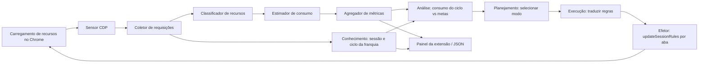
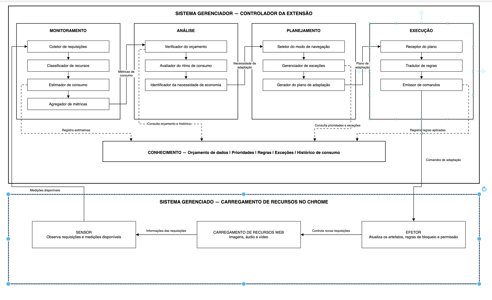

# Da arquitetura à primeira implementação

A entrega 0.9.0 implementa monitoramento, calendário da franquia e adaptação por consumo: a Análise compara os bytes acumulados do ciclo com as metas internas do sistema; o Planejamento escolhe Normal/Econômico/Restritivo; a Execução traduz o plano; o Efetor aplica regras declarativas na aba monitorada. A base de Conhecimento mantém o calendário, os parâmetros e o contador do ciclo persistentes, além dos registros temporários da captura. Alertas persistentes de consumo estão disponíveis; a consulta ao histórico de sessões anteriores segue pendente.

## Fluxo implementado

As regras atuam sobre novas requisições. Após cada lote de observações, o controlador reavalia os limites, atualiza o plano e publica o modo confirmado pela API. Isso cria um feedback básico de consumo, sem ainda analisar ritmo em relação ao tempo restante da franquia.

| Componente da figura    | Arquivo                                         | Responsabilidade atual                                                          |
| ----------------------- | ----------------------------------------------- | ------------------------------------------------------------------------------- |
| Sensor                  | `extension/sensors/chrome-network-sensor.js`    | Início explícito da sessão; acompanha a aba ativa e seus contextos filhos       |
| Coletor                 | `extension/monitoring/request-collector.js`     | Normaliza eventos, separa requisições por contexto e preserva redirecionamentos |
| Classificador           | `extension/monitoring/resource-classifier.js`   | Usa tipo do Chrome e MIME; diferencia áudio/vídeo quando possível               |
| Estimador               | `extension/monitoring/consumption-estimator.js` | Interpreta tamanho conhecido, parcial, cache e indisponibilidade                |
| Agregador               | `extension/monitoring/metrics-aggregator.js`    | Consolida bytes e contadores por recurso/domínio e média por minuto             |
| Conhecimento            | `extension/knowledge/`                          | Guarda a sessão temporária e a configuração persistente do orçamento            |
| Controlador da extensão | `extension/background.js`                       | Coordena sensor, sessão, mensagens e o ciclo de adaptação                       |
| Interface               | `extension/ui/`                                 | Apresenta dados, controla captura e exporta evidências                          |

O controlador faz a ligação entre componentes. O coletor chama o classificador ao receber metadados; o agregador consulta o estimador ao consolidar os registros. O fluxo do diagrama é lógico, sem criar processos ou microserviços para cada caixa. Os módulos são JavaScript com ES Modules e não exigem bundler, facilitando carregar o protótipo e depurá-lo.

## Decisões técnicas

**CDP no sensor.** `chrome.webRequest` é uma opção para observar requisições e foi discutida no histórico, mas `Content-Length` pode estar ausente e não representa sozinho a transferência efetiva. Neste protótipo o domínio Network fornece bytes recebidos, duração e indicadores de cache. A troca preserva a arquitetura e fica isolada no adaptador do sensor. O custo é a permissão ampla `debugger`, o aviso visível no Chrome e a possibilidade de desconexão ao abrir DevTools.

**Eventos e conclusão.** `requestWillBeSent` cria o registro; `responseReceived` acrescenta status/MIME; `dataReceived` atualiza valores parciais; `loadingFinished` substitui a transferência pelo total final. Redirecionamentos geram registros separados. `loadingFailed` registra falha. Encerrar a captura preserva bytes parciais e marca pendências como interrompidas.

**Contextos filhos.** A instrumentação usa sessões CDP planas, disponíveis via `chrome.debugger` a partir do Chrome 125. Novos iframes/workers dedicados são instrumentados antes de continuar sua execução, reduzindo a perda de eventos iniciais. Isso pode introduzir atraso de instrumentação. IDs são isolados por contexto; transições de alvo com ID inequívoco podem ser correlacionadas. Contextos não instrumentados podem deixar cobertura parcial.

**Conhecimento limitado.** O histórico é apenas da sessão atual e desaparece ao reiniciar o Chrome. Plano, franquia e ativação automática persistem localmente. As metas são parâmetros internos da política, não preferências do usuário. Desde a versão 0.6.0, o consumo dos modos é o acumulado persistente do ciclo da franquia. Histórico de sessões, prioridades e exceções permanecem futuros. O armazenamento recebe somente modelos normalizados, sem corpos ou headers das requisições.

**Interface persistente.** O painel usa conexão de mensagens para receber atualizações agrupadas em intervalos de 250 ms, evitando renderizar a cada pacote recebido. A tabela apresenta 100 registros por vez, com opção de mostrar mais; as métricas incluem todos os registros retidos. A captura continua ao fechar o painel, até ser encerrada ou desconectada.

## Arquitetura proposta pela equipe

Análise, Planejamento, Execução e Efetor já possuem implementações básicas na etapa 1. Avaliação do ritmo por período, exceções e histórico permanente continuam na evolução documentada em [PROXIMAS-ETAPAS.md](PROXIMAS-ETAPAS.md).

## Troca automática de abas (0.2.0)

O controlador observa `tabs.onActivated`, `tabs.onUpdated` e `windows.onFocusChanged`. A captura continua sendo iniciada e encerrada explicitamente pelo usuário; durante a sessão, trocar de aba não exige novos comandos. As transições e os comandos são serializados para evitar duas conexões concorrentes.

Antes de desconectar o alvo anterior, seu identificador é retirado do estado de captura. Pendências são marcadas como interrompidas; registros concluídos e métricas permanecem. O novo alvo é conectado automaticamente quando sua URL é HTTP(S). Cada registro carrega `tabId` e `pageUrl`, e as chaves internas isolam aba, contexto CDP e requisição. Isso impede misturar IDs iguais vindos de abas diferentes.

Páginas internas/vazias deixam a sessão em espera, e a navegação posterior para HTTP(S) retoma a conexão. Abrir o painel da própria extensão preserva o último alvo, para permitir acompanhar a página no painel amplo. Fechar uma aba não encerra a sessão. Cancelar a depuração pelo Chrome encerra a captura, respeitando a escolha do usuário. O histórico acumula as abas observadas; a observação em si continua limitada a um alvo por vez.

## Consumo por aba (0.3.0)

O **Agregador de Métricas** também consolida os registros por `tabId` em `metrics.byTab`. Para cada aba, mantém transferência observada, contagem de requisições, pendências e tamanhos desconhecidos. Os subtotais são ordenados por bytes decrescentes, com ordem original da aba nos empates; sua soma equivale ao total observado da sessão. Registros antigos sem `tabId` são associados ao alvo original da sessão.

A interface apresenta esse resultado em um ranking global, separado dos filtros da tabela, e destaca a maior transferência positiva (incluindo empates). Essa consolidação implementa uma responsabilidade do Agregador já previsto na arquitetura. O ranking continua sendo uma agregação. A decisão de adaptação é feita separadamente pelo analisador de orçamento e pelo planejador adicionados na versão 0.4.0.

## Componentes de adaptação (0.4.0 / item 1)

| Responsabilidade                              | Arquivo                                          | Comportamento                                                                          |
| --------------------------------------------- | ------------------------------------------------ | -------------------------------------------------------------------------------------- |
| Verificar orçamento e identificar necessidade | `extension/analysis/budget-analyzer.js`          | Compara transferência da captura com os limites, calcula percentual e saldo estimado   |
| Selecionar modo e gerar plano                 | `extension/planning/adaptation-planner.js`       | Normal abaixo de X, Econômico em X, Restritivo em Y; mantém motivo explícito           |
| Traduzir regras                               | `extension/execution/rule-translator.js`         | Gera regras para mídia/imagem e caminhos comuns de arquivos via Fetch/XHR              |
| Emitir/aplicar comandos                       | `extension/effectors/chrome-request-effector.js` | Substitui atomicamente apenas as regras próprias, com `tabIds`, e confirma o resultado |

As regras de sessão usam IDs reservados 9001 a 9004 e nunca bloqueiam tipos HTML, CSS, scripts ou fontes. Ao trocar de aba, o controlador remove as regras do alvo anterior antes de instalar as do novo. Encerrar, desativar a economia ou voltar a Normal remove os bloqueios. A fila do controlador serializa comandos e atualizações, evitando concorrência entre troca de aba e aplicação das regras.

A interface separa o modo confirmado do modo pretendido se a API falhar. A confirmação da API não garante cobertura de todos os players: os testes verificam também que recursos conhecidos não chegaram ao servidor. A classificação por tipo e caminho não cobre toda mídia servida por Fetch/XHR, service workers ou URLs opacas. Dados já recebidos não são recuperáveis; o controle complementar da versão 0.5.0 pausa a reprodução e oculta imagens em elementos suportados.

Na versão 0.4.0, a base era exclusivamente a captura; desde 0.6.0, usa-se a soma persistente do ciclo entre reinicializações. O avaliador de ritmo em relação ao período da franquia, o gerenciador de exceções e o histórico persistente ainda não estão implementados.

## Metas do sistema e controle da reprodução (0.5.0)

A meta é preservar a franquia. A política `extension/knowledge/adaptation-policy.js` define os critérios experimentais de 70% e 90%, utilizados pela Análise. A configuração do usuário contém o plano, a franquia e a ativação automática, sem campos X/Y. Configurações antigas são migradas para o novo formato e seus percentuais não influenciam a decisão. O Planejamento segue selecionando o modo automaticamente.

O **Efetor** passa a ter duas ações complementares: as regras DNR economizam os próximos downloads; `chrome-content-effector.js` e `page-content-guard.js` interrompem a reprodução já carregada. Através de um mundo isolado CDP, o controle pausa/silencia áudio e vídeo HTML, impede novas tentativas de reprodução, oculta esses controles enquanto bloqueados e oculta imagens HTML/SVG no Restritivo. Observa novos elementos e shadow roots abertos e é instalado também nos iframes instrumentados.

A aba é silenciada como proteção adicional para Web Audio e players sem elementos HTML acessíveis. Isso garante silêncio, mas não significa que o processamento interno desses players foi suspenso nem que todos os seus downloads opacos foram cancelados. O bloqueio de rede mantém as limitações documentadas. Backgrounds CSS e representações gráficas específicas não são tratados pelo controle de imagens já exibidas.

Há uma ampliação concreta do ponto de atuação: além da filtragem das requisições, o Efetor controla temporariamente reprodução e apresentação no DOM. O sistema gerenciado continua sendo os recursos web no Chrome; a documentação deve explicitar essa ação complementar, pois bloquear somente a rede não interrompe conteúdo já em buffer. Os arquivos HTML do servidor não são alterados.

Ao voltar a Normal, desativar, encerrar ou liberar uma aba, a extensão restaura suas alterações sem iniciar áudio automaticamente nem desfazer um silenciamento prévio do usuário. O controle da página tem uma duração renovada enquanto a captura está ativa; se a extensão for desconectada/recarregada, ele expira e restaura a página. O reinício também recupera silenciamento que tenha sido deixado pela própria extensão.

Os testes reproduzem áudio em Normal antes de atingir a meta, tentam tocar novamente pelo buffer após a adaptação, verificam mídia embutida em iframe de outra origem, renovação do controle e retorno ao Normal por ação do usuário. O calendário foi acrescentado na versão 0.6.0 e os alertas na 0.7.0; o histórico de sessões segue como próximo incremento.

## Calendário e consumo da franquia (0.6.0 / item 2)

`knowledge/billing-cycle.js` calcula ciclos mensais ancorados na data inicial ou períodos fixos de 1–366 dias. Aritmética de datas civis evita erros por horário de verão; os limites são meias-noites locais e o final é exclusivo. O ciclo mensal respeita meses curtos e ano bissexto sem perder o dia original. Uma data futura mantém a contabilização e a adaptação suspensas até começar.

`knowledge/budget-usage.js` mantém o acumulado e checkpoints por ID de requisição da captura. As atualizações CDP são reconciliadas antes/depois do evento: a renovação fecha o período anterior antes dos novos bytes; totais finais substituem parciais e correções não retiram bytes de outras requisições ou de ciclos anteriores. Total e checkpoints são gravados em um documento em `storage.local`, separado da sessão temporária. Nenhuma URL é incluída nesse documento.

O controlador reconcilia o período, agenda `chrome.alarms`, persiste o acumulado e entrega consumo e calendário à Análise. A renovação recalcula o plano e restaura Normal quando aplicável. Iniciar/limpar captura ou reiniciar o navegador não apaga o acumulado do ciclo. Alterações do plano preservam o valor já observado. O painel distingue consumo da franquia de métricas da captura; persistência com falha é informada ao usuário.

Essa entrega cobre parte de **Conhecimento** (orçamento e consumo) e do **verificador do orçamento**, mantendo a seleção de modo e os efetores anteriores. O período já está disponível para uma futura avaliação de ritmo diário, mas a política continua baseada em 70%/90% do total, sem regras novas de ritmo. O histórico consultável continua pendente; os alertas foram acrescentados na versão 0.7.0.

O teste real fecha/reabre o Chrome com o mesmo perfil temporário e comprova persistência, inicia outra captura sob a mesma franquia e dispara um alarme real com relógio controlado no teste, verificando renovação sem consulta do painel e retirada dos bloqueios. O produto não possui mecanismo de teste para forçar datas ou zerar o consumo. O contador segue limitado às medições retidas e aos períodos efetivamente monitorados; não representa a fatura da operadora.

## Alertas de consumo (0.7.0 / item 3)

`alerts/consumption-alerts.js` interpreta a análise de orçamento e gera avisos em 70%/90% (metas compartilhadas com `adaptation-policy.js`) e 100%. Esse componente observa o orçamento independentemente da ativação dos bloqueios, sem introduzir nova política de adaptação. A interface apresenta o estado atual e o controlador emite a notificação nativa, como ações de comunicação ao usuário.

`knowledge/alert-store.js` persiste marcos emitidos e confirmados, o identificador do ciclo e eventual falha de notificação. O contador e os checkpoints do item 2 continuam separados e preservados. A renovação natural, identificada por `lastRenewedAt`, reinicia os marcos; editar o calendário com consumo preservado não simula uma renovação nem repete avisos. A configuração migra sem perder franquia/datas e acrescenta `notificationsEnabled`.

A fila do controlador serializa publicação e confirmação. A mensagem **Entendi** inclui faixa e identificador do ciclo: uma tela antiga não pode confirmar uma faixa superior ou um ciclo novo. A marca de tentativa é gravada antes da chamada nativa, favorecendo não repetir notificações após um reinício. Isso não é uma transação com o sistema operacional: se o processo cair nesse intervalo, o aviso continua no painel, mas o banner nativo pode não ser entregue. Falhas de persistência impedem o envio; falhas da API mantêm o aviso e são informadas no painel.

O teste de navegador usa um documento de imagem da extensão como canal de consulta, sem manter um painel de usuário aberto. Observa chamadas encaminhadas à API real, cruza faixas, confirma o aviso, fecha/reabre o Chrome e verifica o novo ciclo. O teste não afirma visibilidade do banner do sistema operacional em execução headless. A consulta a sessões antigas é o item 4 e permanece fora deste incremento.

## Aviso de consumo na página (0.8.0 / complemento do item 3)

`effectors/chrome-page-alert-effector.js` apresenta o estado dos alertas no frame principal da aba monitorada. `page-consumption-alert.js` cria um cartão em Shadow DOM com texto seguro via `textContent`, estilos próprios e opção de recolher para um indicador de percentual. Não replica o cartão em iframes. O aviso independe do modo de economia e da preferência por notificações nativas.

O botão comunica confirmação por `Runtime.addBinding` restrito ao mundo isolado do aviso. O controlador valida a faixa e o identificador do ciclo pelos mesmos critérios do painel e persiste a confirmação. O estado da franquia, as regras de adaptação e a política de 70%/90%/100% permanecem iguais. O indicador continua informando o percentual após confirmar, e pode reabrir o cartão localmente.

A transição entre abas remove o aviso anterior antes de desconectar o sensor. Navegação/recarregamento reinstala a apresentação no frame principal, e uma duração renovável de seis segundos remove elementos órfãos se a extensão for desconectada. O encerramento remove cartão e indicador. Desde 0.9.0, a apresentação permanece no Normal, antes dos alertas e após renovar o ciclo, mostrando modo e percentual. As cores seguem o modo aplicado, independentemente da faixa numérica do alerta; desligar a adaptação mantém o monitor verde, mesmo com aviso de consumo alto. Uma falha de apresentação não interrompe o monitoramento e é indicada no painel. Essa ação de comunicação amplia a interface do sistema gerenciador sobre o sistema gerenciado, sem acrescentar política de bloqueio ou permissão de acesso a sites.

Na versão 0.9.0, o controlador renova a apresentação durante toda a captura, inclusive sem alertas, mantendo a duração de limpeza ao desconectar. O estado `normalDismissed` preserva o recolhimento do monitor Normal por ciclo, sem emitir notificações nativas nem suprimir avisos de faixas superiores. Os testes em Chrome verificam os fundos verde/amarelo/vermelho nos três modos, o posicionamento inferior e o monitor verde após a renovação.
