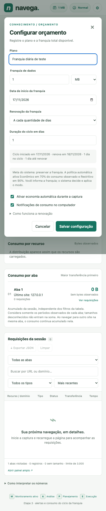

# Item 2 — período e renovação da franquia (0.6.0)

## Instalar e configurar

1. Atualize o repositório e clique em **Recarregar** no cartão do Navega em `chrome://extensions`. Reabra o painel. A extensão acrescenta `alarms` para verificar a renovação com o painel fechado.
2. Abra a engrenagem. Informe plano, franquia e **Data de início da franquia**. Configurações antigas recebem inicialmente um ciclo mensal a partir de hoje: ajuste a data real.
3. Escolha **Mensal, na data de início**. Confira a prévia: início, renovação, duração e dias até renovar. Dia 1 significa renovação na virada do mês; dia 17 significa dia 17 de cada mês. O dia 31 usa o último dia dos meses mais curtos.
4. Experimente **A cada quantidade de dias**, informe por exemplo 30 e confira a prévia. Esse ciclo tem 30 dias corridos; ele não acompanha automaticamente meses de 28 ou 31 dias. Salve a opção desejada.

## Validar o acumulado

1. Para uma demonstração pequena, use **1 MB** e início hoje. Execute `npm run demo`, abra `http://127.0.0.1:4173`, inicie a captura e recarregue a página.
2. Consuma os recursos da demo. O bloco dos modos mostra **utilizado neste ciclo** e a próxima renovação. Os cartões, a tabela e o ranking continuam mostrando a captura atual, portanto podem ter valores diferentes do ciclo.
3. Encerre a captura e anote o consumo do ciclo. Clique em **Limpar**: os registros são apagados, mas o consumo da franquia permanece.
4. Inicie outra captura. O acumulado anterior continua e o modo usa esse total. Se já estiver em Econômico/Restritivo, a proteção é aplicada novamente.
5. Encerre, feche totalmente o Chrome e reabra. O total da franquia e as datas permanecem. Os registros da captura ainda são temporários; a consulta de sessões antigas será o item 4.
6. Edite nome, quantidade ou datas. O consumo já contabilizado é preservado. Aumentar a franquia pode reduzir o percentual e liberar o modo; isso não apaga bytes.

## Validar a renovação

Para observar naturalmente na próxima meia-noite, configure **A cada quantidade de dias**, **1 dia**, com início hoje. Antes da renovação, atinja um modo de economia e deixe a captura ativa. Na data indicada, o consumo do ciclo vai a zero e o modo volta a Normal; a tabela e o ranking da captura permanecem. Imagens ocultadas são restauradas e a reprodução é liberada, sem play automático. Se o navegador estiver fechado, a conferência acontece ao reabrir.

Não é necessário mudar o relógio do computador. Para validar agora, execute `npm run test:e2e`: o teste `tests/cycle-browser.js` utiliza perfil temporário, fecha/reabre o Chrome e controla somente o relógio do processo de teste para exercitar um alarme real. A evidência fica em `artifacts/cycle-verification.json`, com screenshots. Não há comando de reset ou simulação na interface da extensão.

## Limites desta entrega

O acumulado é uma estimativa apenas do que a captura observou, com o mesmo limite de 3.000 registros por captura. Ao atingir esse limite, inicie outra captura para continuar a contabilização do ciclo. Não consulta a operadora, não recupera tráfego anterior à instalação e não conta abas inativas, outros aplicativos ou uploads. Remover a extensão ou apagar seus dados locais elimina a configuração e esse acumulado. São usados a data e o horário do dispositivo.

A persistência do total é uma dependência do item 2. Alertas de consumo (item 3) estão disponíveis desde 0.7.0: [TESTE-ETAPA-3.md](TESTE-ETAPA-3.md). O histórico consultável de sessões/ciclos anteriores (item 4) ainda não foi implementado.
