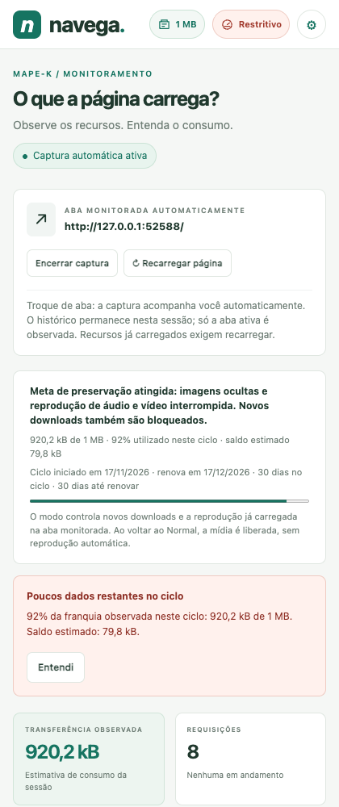

# Item 3 — alertas e persistência do consumo (0.7.0)

1. Atualize o repositório, recarregue o Navega em `chrome://extensions` e reabra o painel. A nova permissão `notifications` permite avisar com o painel fechado. A atualização preserva a franquia e o consumo do ciclo já configurado.
2. Para uma demonstração curta, configure **1 MB**, início hoje, economia automática e **Notificações de consumo no computador** ativas. Se o ciclo atual já estiver consumido, use um perfil separado de teste; limpar a captura não zera a franquia.
3. Execute `npm run demo`, abra `http://127.0.0.1:4173`, inicie a captura e recarregue a página. Use **Consumir 100 kB de teste** até passar de 70%. O aviso deve apresentar percentual, total consumido e saldo estimado. O modo Econômico continua seguindo a mesma regra.
4. Feche e reabra o painel. O consumo e o aviso continuam; a notificação do computador não deve se repetir na mesma faixa. Clique em **Entendi**: o aviso é confirmado sem apagar consumo ou desativar a economia.
5. Continue até 90%: aparece outro aviso. Continue até 100%: o aviso passa a **Franquia estimada atingida**. Os marcos são do sistema; o usuário não configura percentuais. Um salto direto a 100% gera somente o alerta mais alto, sem três notificações em sequência.
6. Faça parte do consumo com o painel fechado, mantendo a captura ativa na demo. A extensão solicita a notificação do Chrome. Clicar nela abre o painel. A exibição no computador depende das permissões de notificações do Chrome e do modo Foco/Não Perturbe do sistema operacional; isso não impede o aviso no painel.
7. Encerre a captura, feche totalmente o Chrome e reabra. O acumulado do ciclo continua. Um aviso ainda não confirmado reaparece no painel; um aviso confirmado continua oculto. O reinício não repete a notificação da mesma faixa.
8. Na engrenagem, desmarque **Notificações de consumo no computador**. Essa preferência persiste ao reabrir e os avisos do painel continuam funcionando. Os alertas também funcionam se você desativar apenas a economia automática.
9. Na próxima renovação, o total volta a zero e os marcos dos alertas reiniciam. Consulte o [roteiro do ciclo](TESTE-ETAPA-2.md). Editar o plano ou a data, por si só, não limpa os marcos já emitidos.

Os bytes são estimativas dos períodos monitorados, não a fatura da operadora. Ao atingir 100%, as regras de adaptação atuais continuam: não foi criado um bloqueio de toda a navegação.

Validação automatizada: `npm run check`, `npm test` e `npm run test:e2e`. O teste `tests/alerts-browser.js` exercita a API real do Chrome, painel fechado, confirmação, reinício e renovação com perfil temporário. A visibilidade do banner do sistema operacional requer a conferência manual acima. Evidências em `artifacts/alerts-verification.json` e `artifacts/alerta-consumo.png`.

Esta entrega cobre somente o item 3. O histórico consultável da sessão anterior, item 4, permanece pendente.
