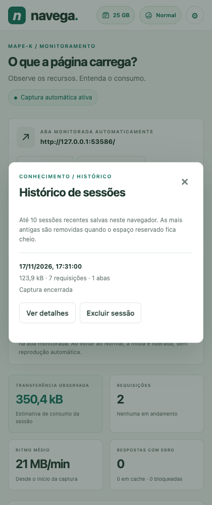

# Item 4 — sessões anteriores (0.10.0)

1. Recarregue o Navega em `chrome://extensions` e reabra o painel. O histórico começa a ser gravado nesta versão; não é possível recuperar sessões descartadas antes dela.
2. Execute `npm run demo`, abra `http://127.0.0.1:4173`, inicie a captura, recarregue e carregue alguns recursos. Anote os bytes da sessão e encerre a captura.
3. Clique em **Histórico de sessões**, ao lado dos controles de captura. A sessão encerrada deve aparecer com data, bytes, requisições e abas. Em **Ver detalhes**, consulte os cartões, o ranking e a tabela. Teste os filtros e **Exportar JSON**.
4. Clique em **Voltar à captura atual**, comece outra captura e carregue recursos diferentes. Abra a sessão anterior novamente: seus números permanecem iguais, enquanto a captura nova continua recebendo recursos. O orçamento no topo e o monitor flutuante continuam sendo do ciclo atual.
5. Altere o plano atual e exporte uma sessão antiga. O JSON deve conter a sessão e o orçamento da época, com `historical: true`, sem misturar os dados da captura atual.
6. No histórico, use **Excluir sessão**. Somente aquele registro é removido. Confira que o consumo da franquia permanece igual e que a captura atual continua ativa. A captura que ainda está ativa não pode ser excluída pelo histórico.
7. Encerre e use **Limpar** nos registros atuais. A tabela atual é limpa, mas a sessão continua no histórico e o consumo da franquia não zera.
8. Inicie outra captura e gere recursos. Aguarde alguns segundos para o ponto de recuperação ser salvo. Feche totalmente o Chrome sem encerrar a captura e reabra. No histórico, ela aparece como **Interrompida · último ponto salvo**. Confira os dados; uma recuperação não inicia monitoramento sozinha nem soma esses bytes outra vez na franquia.
9. Confira também a tela estreita do painel lateral. Os controles do histórico e a faixa de consulta devem caber sem rolagem horizontal.

São guardadas até **10 sessões**, incluindo a captura ativa, dentro de **4 MB** reservados ao histórico. As mais antigas podem ser removidas para preservar as novas. Cada captura continua limitada a 3.000 requisições. Uma interrupção abrupta preserva somente o último ponto gravado, não eventos que ainda estavam em memória. Remover a extensão ou apagar seus dados locais elimina o histórico.

Dados ficam somente neste navegador. URLs continuam sem query, fragmentos ou credenciais, mas caminhos podem conter informações pessoais. O histórico não representa a fatura da operadora e sua exclusão não é uma renovação da franquia.

Validação: `npm run check`, `npm test` e `npm run test:e2e`. O teste `tests/history-browser.js` usa Chrome com perfil temporário para consultar durante captura ativa, filtrar, exportar, excluir sem alterar a franquia e recuperar uma captura após fechar/reabrir o navegador. Evidências em `artifacts/history-verification.json`, `historico-lista.png`, `historico-detalhes.png` e `historico-lateral.png`.
